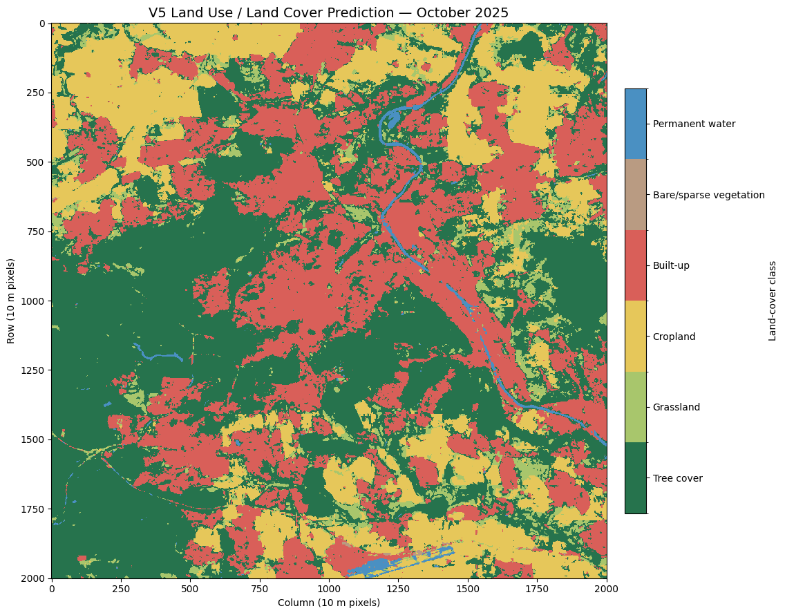
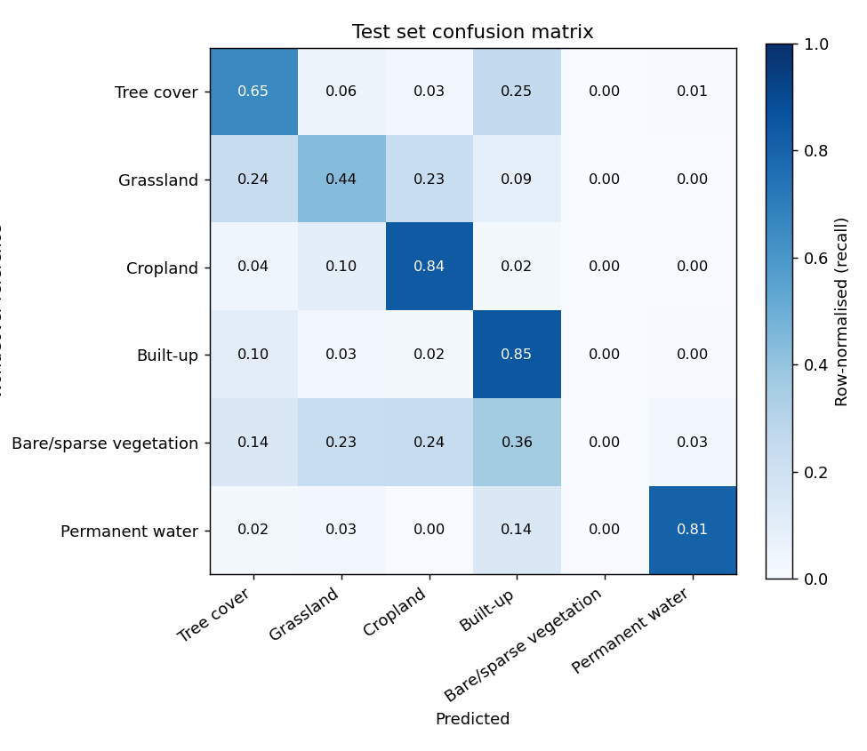

# Sentinel-1 LULC Mapper

Monthly land use / land cover (LULC) segmentation from **Sentinel-1 radar alone**, with a prototype that maps any
location for 12 consecutive months and reports how the class composition changes.

* **Input:** Sentinel-1 IW GRD, VV and VH backscatter (dB), monthly median composites at 10 m
* **Labels:** ESA WorldCover 2021, remapped to 6 classes — tree cover, grassland, cropland, built-up,
  bare/sparse vegetation, permanent water
* **Model:** U-Net (1.94 M parameters), PyTorch
* **Study area:** Stuttgart, Germany (training, validation and test locations are spatially separated)
* **Prototype:** Streamlit app and CLI — latitude/longitude + start month → 12 maps, class shares, changes in
  percentage points

Full technical report: [`docs/report/Sentinel1_LULC_Technical_Report.docx`](docs/report/Sentinel1_LULC_Technical_Report.docx)

## Key results

| Evaluation (against ESA WorldCover 2021) | Pixel accuracy | mIoU |
|---|---:|---:|
| Validation, best checkpoint (epoch 6) | 0.847 | 0.545 |
| **Held-out test set** (27 locations × 12 months) | **0.719** | **0.473** |
| Same test predictions, 4 classes (grass + crop + bare merged) | 0.770 | 0.643 |
| Prototype run, south-west of Stuttgart (5 km × 5 km, 12 months) | 0.911 | 0.411 |

Test IoU per class: water 0.68 · cropland 0.66 · built-up 0.63 · tree cover 0.54 · grassland 0.33 · bare/sparse 0.00.
The merged-class row re-scores the same predictions; it is not a different model (see [Ablation](#ablation-study)).

## 1. Background and objectives

Optical land-cover products need cloud-free scenes, which makes reliable *monthly* maps difficult in cloudy regions
and seasons. C-band synthetic aperture radar (SAR) images the surface regardless of cloud and daylight, but its
signal depends on surface roughness, geometry and moisture rather than colour, so classes that look different in
optical images can look alike to radar.

The project asks how far a compact segmentation network can get with radar as the only input. Objectives:

1. Build a labelled dataset of Sentinel-1 VV/VH patches with WorldCover labels.
2. Train and evaluate a U-Net on spatially held-out locations.
3. Build a prototype that, for any location and start month, produces 12 monthly maps, the share of each class per
   month, the month-to-month change and the total change (both in percentage points).
4. Analyse which inputs and class pairs limit the model (ablation study).

## 2. Data

| Item | Value |
|---|---|
| Radar | `COPERNICUS/S1_GRD` (Earth Engine): IW mode, VV + VH in dB, descending pass |
| Compositing | Monthly median, October 2025 – September 2026 |
| Labels | `ESA/WorldCover/v200` (2021): 10 → tree, 30 → grassland, 40 → cropland, 50 → built-up, 60 → bare/sparse, 80 → water; other codes → 255 (ignored) |
| Grid | 10 m, UTM zone 32N (EPSG:32632), 128 × 128 px patches (1.28 km) |
| Study area | Stuttgart core (≈ 20 km × 20 km) plus an outer ring used for extra training locations |
| Training | 8,280 patches = 690 locations (90 original + 600 outer ring) × 12 months |
| Validation | 324 patches = 27 locations × 12 months, all pixels labelled |
| Test | 324 patches = 27 locations × 12 months, all pixels labelled |

Validation and test locations come from the Stuttgart core and are disjoint from the training locations. The test
set is dominated by tree cover (34.7 %), built-up (31.3 %), cropland (17.6 %) and grassland (14.3 %); water is 2.0 %
and bare/sparse only 0.09 %.

**Dataset download:** _link to be added_ (`python scripts/package_dataset.py` builds the archive with a SHA-256
manifest). `notebooks/01_data_collection.ipynb` documents how to rebuild an equivalent dataset from Earth Engine; it
is a reconstruction — the original data-preparation notebooks that produced `train_v5.npz` are not in the repository.

## 3. Preprocessing and features

* **Inputs are the two backscatter channels only.** No hand-crafted features (indices, texture measures, ratios) are
  added; the network learns spatial and cross-polarisation features itself.
* **Normalisation:** per band, (dB − median) / IQR with training-set statistics stored in the checkpoint —
  VV: median −9.04 dB, IQR 3.97 dB; VH: median −15.39 dB, IQR 4.47 dB.
* **Missing pixels** (NaN, ±∞, −9999) are filled with the band median; a month with more than 50 % missing pixels is
  not predicted.
* **Orbit consistency (prototype):** all 12 months use one relative orbit where possible, so changes are not caused by
  a different viewing angle. Fallback order: one descending orbit → one ascending orbit → mixed descending → mixed
  ascending.

## 4. Model and training

| Setting | Value |
|---|---|
| Architecture | U-Net, 4 encoder/decoder levels, 16 base channels, batch norm, skip connections |
| Parameters | 1,942,518 |
| Input / output | 2 × 128 × 128 → 6 × 128 × 128 |
| Loss | Weighted cross-entropy, weights 0.48 (tree, grass, crop, built) · 2.398 (bare) · 1.684 (water), ignore index 255 |
| Sampling | Patches with ≥ 100 bare or water pixels drawn twice as often |
| Optimiser | AdamW, learning rate 1e-3, weight decay 1e-4, no scheduler |
| Batch size / epochs | 4 / 30, best checkpoint by validation mIoU (epoch 6) |
| Seed / hardware | 42 / single CUDA GPU |

Metrics: pixel accuracy, per-class precision, recall and IoU, and mIoU (mean of the six class IoUs), computed from a
confusion matrix over all labelled pixels.

## 5. Workflow

```
lat, lon, start month
  └─ src/location.py   pixel-aligned UTM grid around the point (1–10 km square)
  └─ src/gee.py        check coverage, choose orbit, 12 monthly VV/VH median composites → GeoTIFF
  └─ src/pipeline.py   validate each GeoTIFF (CRS, pixel size, alignment) and reuse valid cached files
  └─ src/inference.py  normalise, 128 px tiles with 64 px overlap, average class probabilities
  └─ src/analysis.py   class shares, month-to-month and total change (pp), transitions, stability
  └─ src/visualize.py  12-month map grid, GIF, charts
```

For month *m* and class *c*: share = pixels of *c* / all pixels × 100; month-to-month change = share(*m*) −
share(*m*−1); total change = share(last) − share(first). Changes are in percentage points and sum to zero across
classes.

## 6. Results

| Notebook / file | Content |
|---|---|
| [`02_train_evaluate_unet`](notebooks/02_train_evaluate_unet.ipynb) | Training, curves, validation and test evaluation |
| [`03_prototype_run`](notebooks/03_prototype_run.ipynb) | Full prototype run for Stuttgart and Frankfurt |
| [`04_ablation_study`](notebooks/04_ablation_study.ipynb) | Feature ablation, class removal, class merging (with outputs) |
| [`results/accuracy/`](results/accuracy) | Test-set and per-location accuracy against WorldCover |
| [`results/ablation/`](results/ablation) | Ablation tables and figures |
| [`results/figures/`](results/figures) | 20 km Stuttgart run (from `notebooks/archive/10_v5_lulc_prototype.ipynb`) |

> Notebooks 01–03 are stored **without outputs**. The training history (`outputs/training_history_v5.json`) lives on
> the lab server; re-run notebook 02 there to embed the training curves before submission.

<p align="center">
  
  
</p>

**Test set (per class).**

| Class | IoU | Precision | Recall |
|---|---:|---:|---:|
| Tree cover | 0.539 | 0.754 | 0.653 |
| Grassland | 0.329 | 0.573 | 0.436 |
| Cropland | 0.656 | 0.752 | 0.838 |
| Built-up | 0.632 | 0.711 | 0.850 |
| Bare/sparse vegetation | 0.000 | 0.000 | 0.000 |
| Permanent water | 0.684 | 0.817 | 0.808 |

Monthly test mIoU ranges from 0.455 (June) to 0.484 (April, with December almost equal); early summer is the hardest period.

**Full-area run, Stuttgart 20 km × 20 km (400.4 km², Oct 2025 → Sep 2026).** Tree cover 44.2 % → 39.7 %
(−4.54 pp), grassland 5.9 % → 10.5 % (+4.58 pp), cropland 19.0 % → 17.0 % (−1.98 pp), built-up 29.9 % → 31.8 %
(+1.86 pp); 13.6 % of pixels have a different class in the last month. Much of this swing is seasonal radar response
rather than land conversion (see Limitations).

**Prototype runs against WorldCover (12 months).** Stuttgart centre 2 km: accuracy 0.791, mIoU 0.202; Stuttgart
centre 5 km: 0.788 / 0.340; south-west of Stuttgart 5 km: 0.911 / 0.411. Accuracy rises with the share of forest;
mIoU for a single site is pulled down by classes with only a few pixels. These runs used non-overlapping tiles; only
the south-west run is stored in `results/accuracy/`.

### Ablation study

All experiments change inputs or outputs of the trained model at test time (`notebooks/04`).

| Experiment | Test mIoU | Δ mIoU |
|---|---:|---:|
| Baseline | 0.473 | — |
| VV replaced by its median / VH replaced by its median | 0.107 / 0.182 | −0.366 / −0.292 |
| Polarisation ratio removed (VH rebuilt from VV) | 0.325 | −0.148 |
| Spatial texture removed / brightness removed | 0.049 / 0.433 | −0.424 / −0.040 |
| Gaussian noise ≈ 1 dB / ≈ 2 dB | 0.395 / 0.231 | −0.078 / −0.242 |

* Both channels are needed; VV is slightly more important. Water fails if either channel is missing.
* **Cropland is recognised through the VH/VV ratio**: removing it drops cropland IoU from 0.66 to 0.01.
* Spatial context matters far more than absolute brightness.
* The dominant confusion is **tree cover ↔ built-up** (merging them alone adds 12 points of accuracy); grassland is
  confused with tree cover and cropland about equally. Merging grassland, cropland and bare/sparse gives a 4-class
  scheme with mIoU 0.643 on the same predictions.

## 7. Installation and usage

Python 3.10–3.12. A GPU is optional for the prototype.

```bash
git clone https://github.com/Mehatab1/DeepLearning.git sentinel1-lulc
cd sentinel1-lulc
python -m venv .venv && source .venv/bin/activate
pip install -r requirements.txt
earthengine authenticate              # headless: python -c "import ee; ee.Authenticate(auth_mode='notebook')"
export EE_PROJECT=your-gcp-project-id
pytest -q                             # 16 offline tests, no Earth Engine needed
```

**Account:** Google Earth Engine with a Cloud project registered for Earth Engine (free for non-commercial use).
No other keys are needed. A service account can be used instead (see `.env.example`).

| Task | Command |
|---|---|
| Web app | `streamlit run app.py` — click on the map or type coordinates, choose start month (2017 or later) and area (1–5 km) |
| Command line | `python run_lulc.py --lat 48.7758 --lon 9.1829 --start 2025-10 --area-km 2` |
| Accuracy check | `python scripts/check_accuracy.py --project $EE_PROJECT` (test set + one location) |
| Package dataset | `python scripts/package_dataset.py` |
| Notebooks | `jupyter lab notebooks/` |

On a remote server the app needs port forwarding, e.g. `cloudflared tunnel --url http://127.0.0.1:8501`.
Each run is written to `runs/<lat>_<lon>_<start>_<size>km/` (inputs, predictions as GeoTIFF, CSV tables, figures).

## 8. Repository structure

| Path | Contents |
|---|---|
| `app.py`, `run_lulc.py` | Streamlit prototype and command-line interface |
| `src/` | `gee` (Earth Engine), `location` (UTM grid), `model` (U-Net), `inference`, `analysis`, `visualize`, `pipeline`, `classes` |
| `notebooks/` | `01` data collection · `02` training and evaluation · `03` prototype run · `04` ablation study |
| `notebooks/archive/` | Original V5 notebooks: training run (`09`), 20 km prototype run (`10`), arbitrary-location development (`11`) |
| `weights/best_unet_v5.pt` | Trained model with normalisation statistics |
| `results/` | `accuracy/`, `ablation/`, `figures/` — curated results used in this README and the report |
| `scripts/` | `check_accuracy.py`, `package_dataset.py` |
| `tests/` | Offline tests with synthetic rasters |
| `docs/` | Technical report, screen-recording plan |

## 9. Limitations and future work

* **Static labels.** WorldCover 2021 is used as the label for every month of 2025–26; scores measure agreement with
  that map, which itself contains errors, not monthly ground truth.
* **Seasonal radar response.** Month-to-month changes mix real change with soil moisture, crop growth and leaf-on/off
  effects; changes of a few percentage points in stable areas are mostly noise.
* **Single region.** Trained and validated around Stuttgart only; results elsewhere and on ascending passes are
  unvalidated.
* **Rare and similar classes.** Bare/sparse is never predicted; grassland stays weak (IoU 0.33).
* **Missing artefacts.** Training curves, notebook 01–03 outputs, the dataset link and the screen recording still
  need to be added.

Future work: retrain on the 4-class scheme suggested by the merging analysis, add multi-temporal input to separate
seasonal effects from change, add locations from other landscapes, re-evaluate the prototype with overlapping tiles
on more sites, and use more recent or independent reference data.

## Submission checklist

| Requirement | Location | Status |
|---|---|---|
| Dataset | download link | to be added |
| Notebooks with results and training curves | `notebooks/` | 04 done; 02 and 03 need re-running with outputs |
| Prototype source, README, requirements | `app.py`, `run_lulc.py`, `src/`, `requirements.txt` | done |
| Trained weights | `weights/best_unet_v5.pt` | done |
| Technical report | `docs/report/` | done |
| Screen recording | link | to be added (plan in `docs/RECORDING.md`) |
